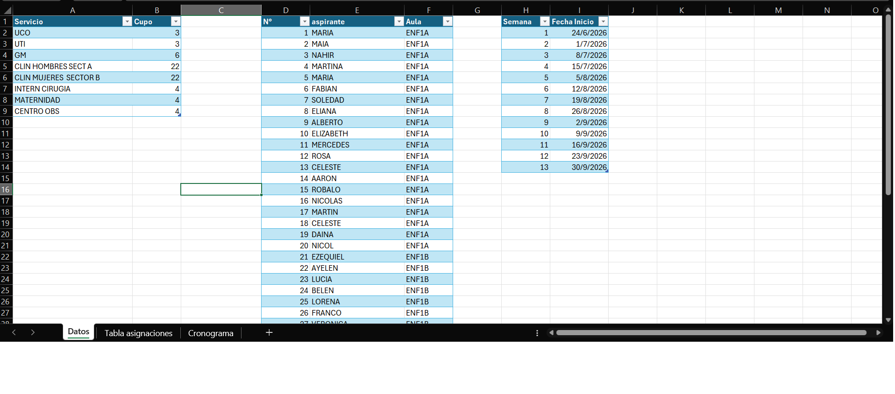
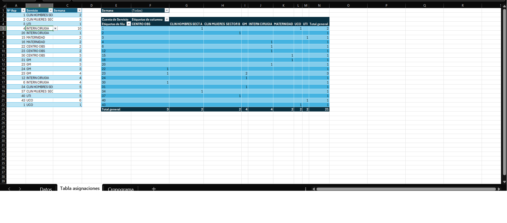
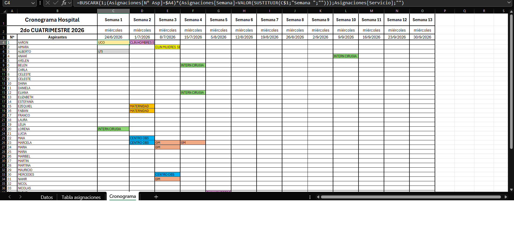

<h1 align="center">Hospital Rotation Assignment, Management, and Control</h1>

  <strong>Technologies:</strong> Excel

## Note on Published Data

The data presented in the published version of this project was anonymized for portfolio purposes. Student, instructor, hospital, and date data was modified where necessary to protect the privacy of the individuals and organizations involved. The system structure, implemented validation rules, and assignment logic correspond to the solution originally developed.

## Context

Hospital rotations are a mandatory component of nursing student´s practical training. Planning these rotations required coordinating students, hospital departments, instructors, and available placement slots while ensuring that each student completed the required practice activities during the academic period. The information was used by both the educational institution and the participating hospitals, making schedule accuracy essential for the successful execution of practical activities.

## Problem

Hospital rotation assignments were managed through manually created schedules that required frequent updates due to availability changes, corrections, and new operational requirements. This process generated recurring errors in student allocation, including excessive numbers of students assigned to specific departments, failure to comply with hospital capacity requirements, and omission of mandatory rotations for some students. In addition, every change required manually reorganizing schedules, updating planning documents, and redistributing information to the different stakeholders, increasing management time and the likelihood of administrative errors. The absence of automated controls made it difficult to validate information before distribution, resulting in rework and recurring corrections.

## Objectives

- Centralize the information required for hospital rotation assignments.
- Automatically validate department capacity limits.
- Reduce errors in student allocation.
- Facilitate schedule reorganization when operational changes occur.
- Simplify schedule generation and distribution to hospitals.

## Solution

An Excel-based tool was developed to transform a manual and distributed process into a structured hospital rotation assignment and control system. Using a centralized database of students, hospital departments, capacity limits, and rotation dates, the solution generated schedules ready for distribution and monitoring. The system incorporated controls to validate capacity utilization, prevent incorrect assignments, and ensure that students completed all mandatory rotations required for their training. In addition, the solution was designed for users with basic Excel knowledge, prioritizing a simple, secure, and maintainable data-entry process without risking damage to formulas or critical file structures.

**Master Database.**

**Assignment Database with Pivot Tables used to validate and monitor rotation schedules.**

## Results

- Significantly reduced the time required to create and update rotation schedules.
- Minimized errors related to capacity limits, duplicate assignments, and incomplete mandatory rotations.
- Simplified student reassignment in response to operational changes or unforeseen requirements.
- Improved the quality of information distributed to hospitals.
- Eliminated a substantial portion of the rework caused by schedule corrections and feedback cycles.

**Automatically generated rotation schedule designed for users with basic Excel knowledge.**

## Tools

- Microsoft Excel for rotation planning and management.
- Structured Tables for organizing and controlling information.
- Data Validation to reduce data-entry errors.
- Control Formulas to verify capacities and assignments.
- Pivot Tables for rotation monitoring and validation.
- User-Centered Design to facilitate use by personnel without advanced Excel knowledge.

## Related Files

You can download and review the complete project files here:
- [Excel Template](source-files/servicios.xlsx)
