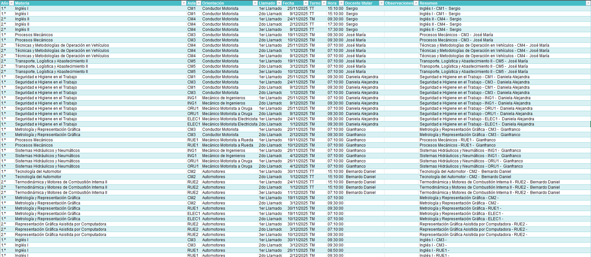
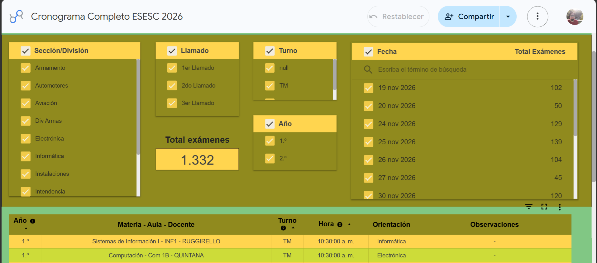

# Institutional Academic Scheduling System: Consolidation, Validation and Automation

  <strong>Technologies:</strong> Excel, Power Query, Looker Studio, Data Modeling

**Note on Published Data**

The data used in the published version of this project was anonymized for portfolio purposes. Student names, instructor names, dates, and academic information were modified to protect institutional and personal information. The structure of the files, validation processes, data model, and visualizations correspond to the original solution. The objective of this project is to demonstrate the scheduling, consolidation, validation, and reporting processes without exposing real institutional data.

## Context

The final examination schedule is one of the most important operational documents within an educational institution. It coordinates teachers, students, classrooms, resources, and academic activities, all of which must be reviewed and approved by different management levels before publication.
The institution offers 11 university technical degree programs, 24 specializations, and 9 faculties. Academic operations involve approximately 400 teachers and more than 2,000 on-site students, in addition to distance-learning programs and complementary training initiatives.
The information generated through these schedules is used by academic, administrative, and management departments, making data quality and consistency essential for the organization's daily operations.

## Problem

Each faculty created its examination schedules using its own files and formats. This made information consolidation difficult, required multiple manual reviews, and increased the risk of scheduling errors.nThe situation was particularly complex because many instructors worked across multiple faculties or specializations, which could lead to timetable overlaps and assignment conflicts. In addition, the schedules had to go through several review and approval stages before publication. The existence of multiple versions and different data-entry criteria hindered communication between the involved departments and increased validation times.

## Objectives

- Standardize the information generated by the different faculties.
- Consolidate all schedules into a single source of information.
- Identify conflicts and errors before the formal approval process.
- Facilitate coordination between teachers, faculties, and administrative departments.
- Reduce review and validation times.

## Solution

A scheduling consolidation and validation system was developed based on a standardized data structure. The solution enabled the integration of information generated by different faculties into a single repository, incorporating controls to detect scheduling conflicts, teacher overlaps, and planning errors before institutional approval. In addition, interactive visualizations were created to facilitate access to and consultation of information by teachers, authorities, and administrative departments.

**Index Schedule Template**

## Results

- Information standardization was achieved, facilitating the adaptation of different faculties to a single data-entry framework.
- Schedule review, validation, and approval processes were improved.
- Academic information was centralized by consolidating data generated across multiple departments.
- Administrative workflows were simplified through the standardization of files and working criteria.
- Information was made available to different management levels through an interactive schedule that provides quick access from both computers and mobile devices.

**Interactive Schedule**

## Tools

- Microsoft Excel for information indexing, file standardization, and operational schedule management.
- Power Query for the consolidation and automated transformation of information from multiple faculties.
- Data Modeling for the unification and standardization of data structures.
- Data Validation to facilitate data entry and reduce input errors.
- Structured Tables and Pivot Tables to simplify the visualization and analysis of consolidated information.
- Control and Validation Formulas to verify dates, exam quantities, and data consistency.
- Looker Studio for interactive schedule visualization and consultation from computers and mobile devices.
