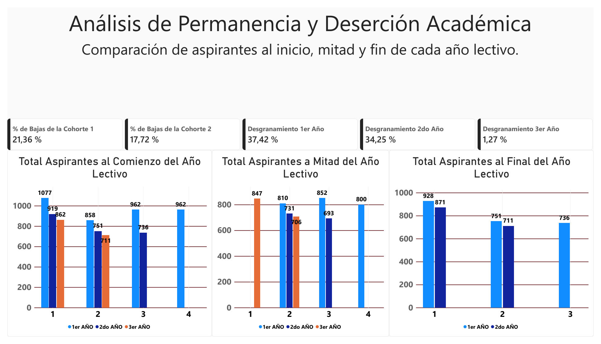
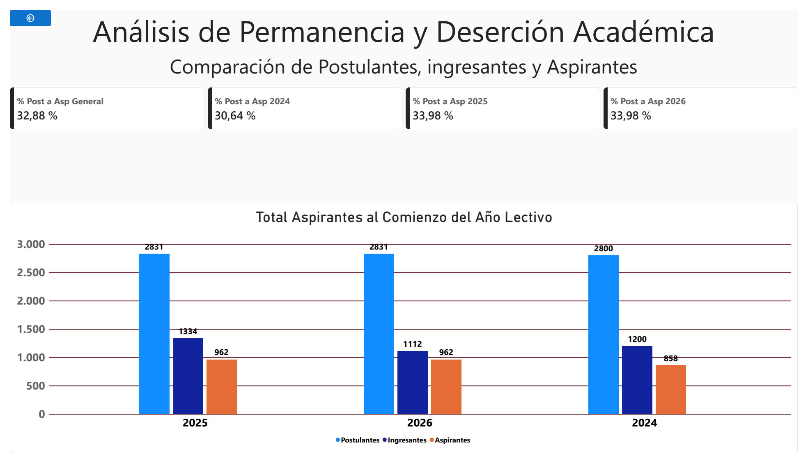
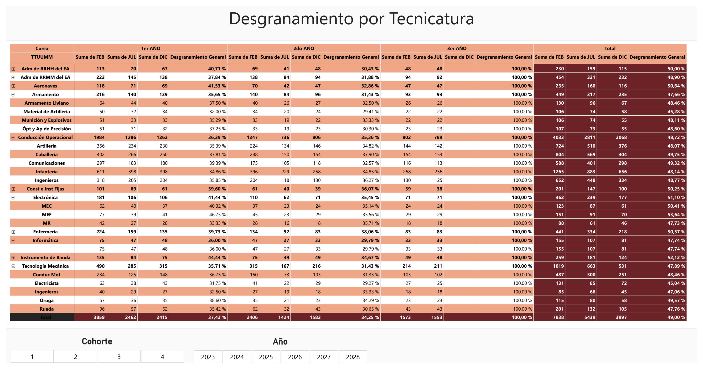

<h1 align="center">Academic Retention and Dropout Analysis</h1>

  <strong>Technologies:</strong> Excel, Power BI, Power Query, DAX

## Data Publication Note

The data used in the published version of this project was anonymized for portfolio purposes. Student counts, percentages, and indicators were modified to protect sensitive institutional information. The visualizations, data model, and analytical logic reflect the original solution developed. The data structure, metrics, and dashboards were preserved to accurately represent the analysis process while avoiding the disclosure of real organizational data.

## Context

The institution monitored academic dropout rates through independent spreadsheets maintained by different departments. Although partial statistics and percentages were available, there was no historical consolidation to validate the results or compare the performance of different cohorts and specializations.
The available information made it difficult to answer simple questions such as:
What is the actual student retention rate?
Are there significant differences between specializations?
At what stage do the highest student losses occur?
How do cohorts evolve over time?
The absence of a unified source of information limited analytical capabilities and complicated the generation of consistent indicators for decision-making.

## Problem

The institution had historical information on academic retention and dropout distributed across multiple independent files. Although partial reports and percentages existed, there was no consolidated source that allowed data consistency to be verified or results to be compared across cohorts, academic years, and specializations. The situation became even more complex due to curriculum changes implemented in 2023, which made comparisons with historical records more difficult and limited the ability to generate reliable institutional indicators.
As a result, it was difficult to accurately answer questions related to student retention, dropout levels by specialization, and the stages of the educational process with the highest student losses. The absence of consolidated metrics limited analysis and reduced the availability of information for management meetings and decision-making processes.

## Objectives

- Consolidate historical retention and dropout information from multiple cohorts and specializations.
- Generate reliable indicators to validate the percentages used in institutional reports.
- Facilitate comparisons between cohorts, academic years, and specializations.
- Identify trends and stages of the educational process with the highest student attrition.
- Provide clear and accessible information for management meetings and decision-making.

## Solution

A process of cleaning, transforming, and consolidating historical information from different academic cohorts was carried out. Due to differences in formats, structures, and data-entry criteria, it was necessary to standardize the data before analyzing it as a unified dataset. Based on the consolidated information, an analytical model was built to measure student retention and dropout from different perspectives, including cohorts, specializations, and stages of the educational process. Finally, an interactive dashboard was developed to visualize institutional indicators, compare historical results, and facilitate access to information for authorities and management departments.

**This Dashboard represents the Desertion and Retention from every cohort per Year**

**This Dashboard represents the Desertion and Retention from entrants, candidates and students when they start the first year of the degree**

**This Dashboards has the Desertion and Retention from every year of the Carreer and their specialities**

## Results

- Historical information previously distributed across multiple independent files was consolidated.
- A single source of information was created for academic retention and dropout analysis.
- Comparable indicators were generated across cohorts, academic years, and specializations.
- Report preparation for management meetings and institutional planning was streamlined.
- A consolidated database was established to support future academic and student performance analyses.

## Tools

- Microsoft Excel for the initial review, organization, and validation of historical information.
- Power Query for cleaning, transforming, and consolidating data from multiple files.
- Data Modeling for structuring and analyzing consolidated information.
- Power BI for developing dashboards and institutional indicators.
- DAX Measures and Calculations for building retention and dropout metrics.
